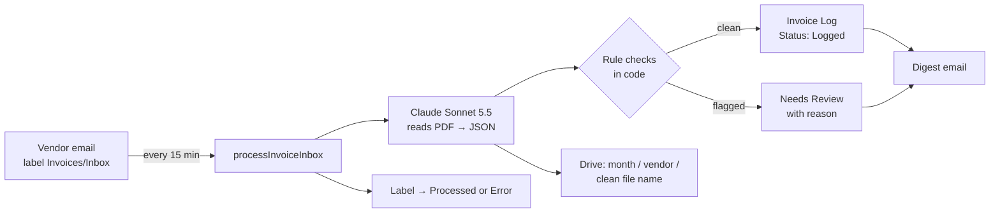

# AI Invoice Processing Agent


> **Vendors email invoices. The agent reads each PDF, logs it to your books sheet, files it with a clean name, and
> only bothers you about the ones that look wrong.**

An AI bookkeeping assistant that runs inside your own Google account. It watches a Gmail label and sends each PDF
invoice to Claude, which reads it directly with no OCR setup. It extracts vendor, dates, line items, and totals,
assigns a general-ledger category, files the PDF in Drive, and flags duplicates, math errors, and large or uncertain
invoices for review.

---

## What it does

| | |
|---|---|
| 📄 **Reads PDFs** | Claude reads the invoice PDF directly: vendor, invoice #, dates, line items, subtotal, tax, total |
| 📒 **Logs to your books** | One row per invoice in an **Invoice Log** sheet, with GL category and confidence |
| 🗂️ **Files cleanly** | Saves to `Invoices/2026-11/Acme Supply/2026-11-03_Acme-Supply_INV-1042_$1,284.50.pdf` |
| 🚩 **Flags exceptions** | Duplicates, totals that don't add up, low confidence, large amounts, missing fields, non-invoices |
| 📬 **Digest** | One summary email per run: count, total $, and exactly which invoices need you and why |
| 🔁 **Never double-logs** | Re-running is safe; each attachment is processed once |

## How it works



**AI extracts, code decides.** Claude does the reading and categorizing, but every approval rule is plain,
deterministic code that an accountant can audit:

| Rule | Flag |
|---|---|
| Same vendor + invoice # already logged | Duplicate (with when the original was logged) |
| \|line items + tax − total\| > $0.02 | Math mismatch (shows both numbers) |
| AI confidence below threshold (default 0.8) | Low confidence |
| Total above review threshold (default $5,000) | Large amount |
| Vendor, invoice #, or total missing | Missing fields |
| Document isn't an invoice | Labeled `Invoices/Error` |

Claude is told to **copy numbers exactly as printed and never fix the arithmetic**, so a vendor's math error is caught
instead of silently "corrected."

## Design principles

- **Exceptions only.** Clean invoices are logged without anyone touching them. People only see the ones that need
  judgment, each with a plain-English reason.
- **Auditable.** Rule checks are code, not AI. Every AI call is logged with tokens and raw JSON.
- **Idempotent.** Each attachment's `<messageId>/<filename>` key is recorded, so retries and re-runs never double-log.
- **Resilient.** API errors retry with exponential backoff (429/5xx, max 3). Failures are labeled for review and
  `retryErrors()` re-queues them.
- **Your data stays in your account.** Gmail, Drive, Sheets, and Apps Script, plus Claude API calls.

## Tech stack

- **Google Apps Script** (V8): Gmail, Drive, Sheets, Docs (for demo PDFs), time-driven triggers
- **Claude API**: `claude-sonnet-5-5` with native PDF input, structured outputs (JSON schema with the GL category as
  an enum from your chart of accounts), and server-side refusal fallback
- **clasp** for local development and deployment

**Estimated AI cost:** about $0.02–0.04 per invoice on Sonnet 5.5. That's 200 invoices a month for under $10.

## Project structure

| File | Purpose |
|---|---|
| [`Code.gs`](Code.gs) | Setup, processing loop, rule checks, Drive filing, sheet logging, digest, demo helpers |
| [`Claude.gs`](Claude.gs) | Claude API client: structured outputs, retries, refusal fallback, AI Log |
| [`SampleData.gs`](SampleData.gs) | Generates 10 realistic fake invoice PDFs (including a duplicate and a math error) and emails them |
| [`appsscript.json`](appsscript.json) | Manifest with the exact OAuth scopes |
| [`SPEC.md`](SPEC.md) | Functional spec, extraction schema, acceptance criteria |
| [`SETUP.md`](SETUP.md) | Step-by-step install and demo script |
| [`CHANGELOG.md`](CHANGELOG.md) | What was built and why |

## Quick start

```bash
npm install -g @google/clasp
clasp login
clasp create --type standalone --title "Invoice Agent Demo"
clasp push
```

Then, in the Apps Script editor:
1. Add the Script Property `ANTHROPIC_API_KEY`.
2. Run `setup()`.
3. Run `seedSampleData()` → `processInvoiceInbox()`.

Full walkthrough: **[SETUP.md](SETUP.md)**.

## Configuration

Set in the generated sheet, with no code changes:

- **Settings tab:** review threshold ($), confidence threshold, Drive root folder
- **Chart of Accounts tab:** your GL categories. Claude can only choose from this list.

## Adapting it for your business

- Point it at your real AP inbox or a shared mailbox label.
- Replace the sheet with QuickBooks, Xero, or a bill-pay tool via their APIs.
- Add PO matching (invoice vs. purchase order) as another rule.
- Add approval routing for flagged invoices. See the companion
  [purchase approval agent](https://github.com/cmishler96/ai-purchase-approval-agent).

## Safety notes

All vendors and data are fictional. The digest only ever goes to the account owner. The API key lives in Script
Properties and never in code. `resetDemo()` trashes demo emails and filed PDFs; Trash is recoverable for 30 days.

## License

[MIT](LICENSE)
